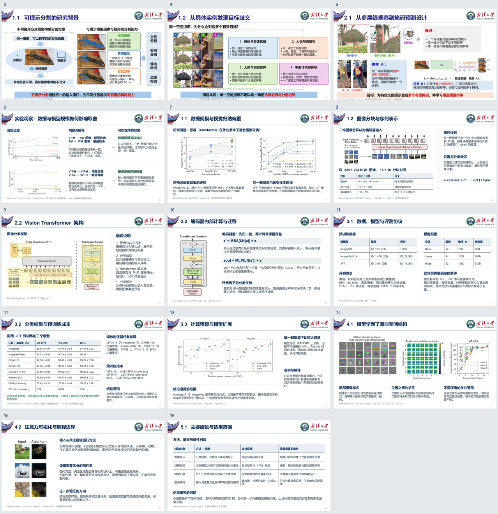
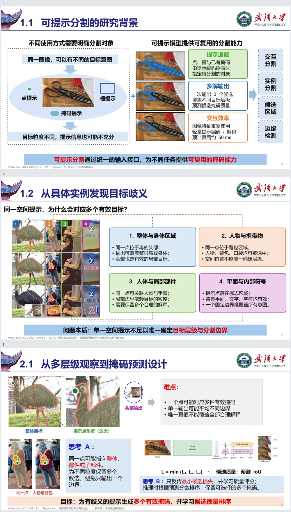
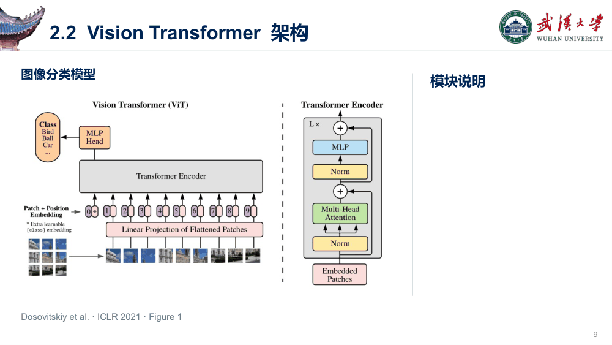

# WHU PPT Skill

用武汉大学的视觉风格，将论文和文稿组织成有图、有机制、有证据的学术汇报。

[下载模板](assets/whu-template.pptx) · [使用规则](SKILL.md) · [完整示例索引](references/examples.md)



## 内容与图文组织

模板含 17 张可编辑页面。Segment Anything 示例展示场景与需求、案例定位、从观察到设计、实验观察与取舍；Vision Transformer 示例展示输入演算、架构解释、实验协议、结果比较、机制分析与研究总结。封面、目录与结束页提供 WHU 品牌构图。两组公开研究是独立页型案例，成稿页数和结构由用户材料决定。



正文不是只替换占位文字：制作时先阅读正文和图注，提取原论文图表，建立问题、设计与证据之间的关系。缺少真实场景或对象图时，主动查找官方和可靠来源。每页按同类示例检查解释层级、证据可读性与图文对应。

中文使用微软雅黑，英文与数字使用 Arial。文字、表格和必要的数据图保持可编辑。示例素材的出处见 [公开素材来源](references/examples.md#公开素材来源)，也记录在幻灯片备注中。

## 动画

普通页面默认静态。仅复杂网络架构、内部计算或多阶段训练机制需要定位局部时，使用方法图联动动画。每次点击显示对应说明与黄色高亮，已出现文字保留，上一处高亮消失。



## 安装与调用

```text
$skill-installer
请从 https://github.com/haodijia/whu-ppt-skill 安装技能。
SKILL.md 位于仓库根目录，请将根目录安装为 whu-ppt。
```

提供论文、文稿或已有 PPT 后直接调用：

```text
$whu-ppt
根据仓库里的两篇论文，制作一份武汉大学风格的学术汇报。
```

也可以补充汇报对象、时长、页数和必须保留的图表。无需额外要求“主动找图”或“增加信息量”；这些已包含在制作规则中。

## 运行环境

- PPTX 制作与导出使用 Presentations 技能及其工具环境。
- 图片获取使用所在环境的网络或图像工具，优先原论文与官方来源。
- 原生动画需要 Microsoft PowerPoint 放映验证；PDF 只呈现静态页面。
- 动画脚本使用 uv 管理 Python 与 lxml。

最终导出后，适用的复杂方法页可执行以下命令，将 `<目标页码>` 替换为成稿中的实际页码（本仓库模板的动画示例在第 9 页）：

```bash
uv run --no-project --with lxml python scripts/apply_focus_animation.py \
  --input draft.pptx --output animated.pptx --slide <目标页码>
```

该页高亮和说明对象分别命名为 `HIGHLIGHT_1…N`、`EXPLAIN_1…N`，一一对应，说明位置互不重叠。脚本重建指定页的联动序列，输入输出必须不同，输出文件不能已存在。详细条件见 [动画规则](references/animation.md)。

## 资源

- [材料与叙事](references/storyboard.md)：任务主线、证据链、合页与拆页
- [页型与完整度](references/page-recipes.md)：各类页面的内容关系和构图
- [背景与问题发现构图](references/composition.md)：场景、局部对照、设计依据与证据组合的具体迁移步骤
- [主动获取图像](references/visual-sourcing.md)：论文图表、场景检索、来源与裁切
- [内容与视觉验收](references/quality-review.md)：具体性、解释完整度、可读性和分发检查
- `assets/whu/`：校徽、校名、校训、标准色与辅助图形
