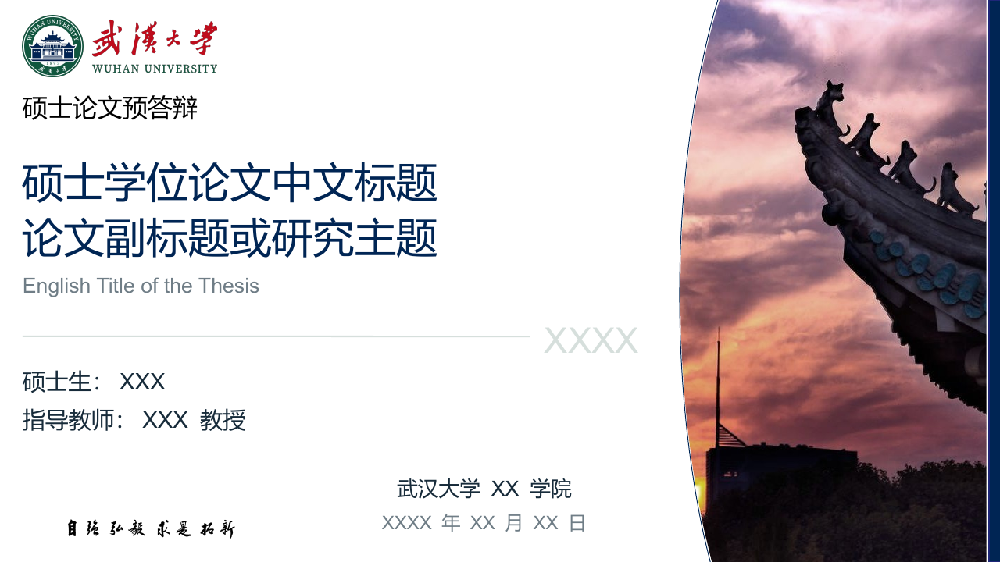
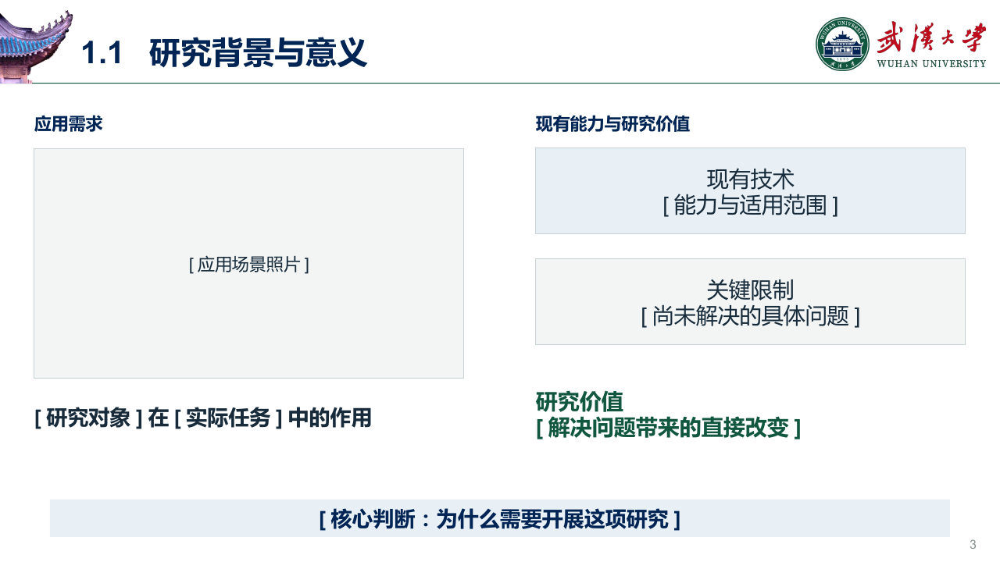
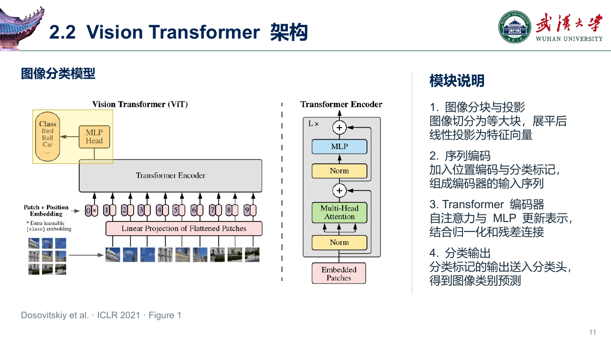
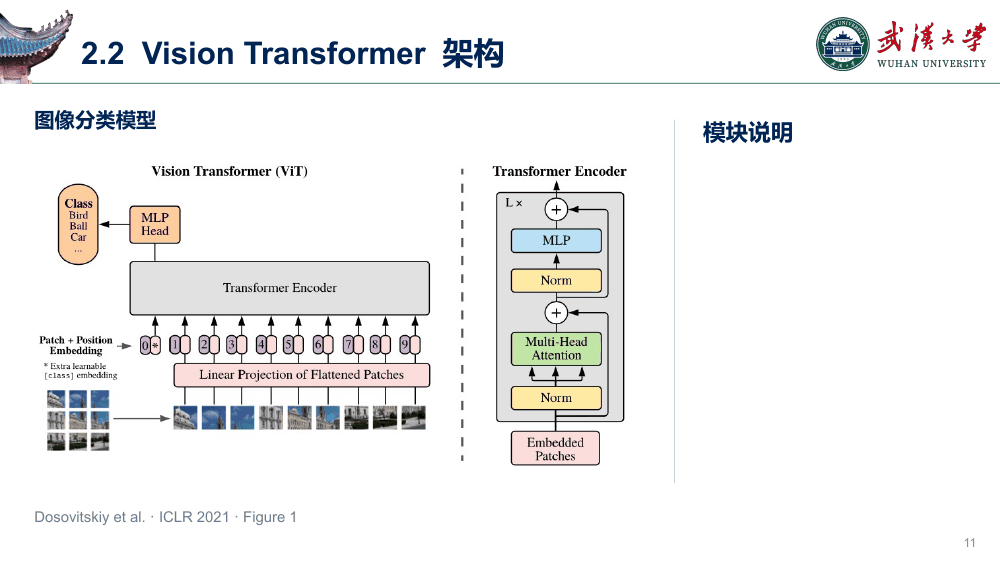

# WHU PPT Skill

**用武汉大学的视觉风格，把研究材料组织成适合现场讲解的学术演示。**

从论文、研究笔记、图表或已有 PPT 出发，梳理论证、选择页型、安排图文，再完成素材补充与讲解动画。适用于论文答辩、开题报告、组会汇报和论文介绍。

[下载 PPT 模板](assets/whu-template.pptx) · [查看 Skill](SKILL.md) · [逐页制作指南](references/page-recipes.md) · [动画规则](references/animation.md)



## 制作思路

先判断材料需要哪些页，再选择合适的构图。章节和页数跟随研究内容与汇报时长，不要求填满模板。

| 环节 | 处理内容 |
| --- | --- |
| 梳理材料 | 建立研究问题、现象证据、方法设计、实验验证与贡献之间的对应关系 |
| 规划页面 | 确定每页要解释、比较或证明什么，选择背景、方法、实验等页型 |
| 先排版 | 安排标题、主图、解释和结论，明确图片比例、主体位置与留白 |
| 补充素材 | 优先使用已有资料；真实场景检索可靠图片，概念示意按版面需求生成 |
| 落图定版 | 调整裁切、图文关系与信息密度，保留可编辑的文字、图表和强调框 |
| 讲解检查 | 检查静态排版及每次点击状态，确认动画与说明同步 |

## 页面预览

### 背景与研究价值

用场景图建立研究对象，再说明现有能力、关键限制和研究价值。图像占位用于替换实际素材，页面底部提炼有证据支持的核心判断。



### 方法架构与模块讲解

整体架构保持可见，右侧说明按阅读顺序排列。图中的黄色区域与当前讲解内容一一对应。



### 逐条讲解动画

**文字逐条出现并保留，黄色高亮依次切换。**

每次点击同时显示下一条说明和对应高亮，并隐藏上一处高亮。讲到最后，全部文字仍然可读。



上图循环展示 PPT 的点击状态；实际放映由演讲者点击推进。

## 安装与使用

### 安装到 Codex

在 Codex 中使用内置的 `$skill-installer`，输入：

```text
$skill-installer
请从 https://github.com/haodijia/whu-ppt-skill 安装技能。
SKILL.md 位于仓库根目录，请将这个根目录安装为 whu-ppt。
```

`whu-ppt` 包含制作规则、模板、品牌素材和动画脚本。模板默认使用硕士学位论文封面，可根据实际汇报修改标题、作者、导师、单位与日期。

Codex 支持从 GitHub 安装技能；若新技能未出现在列表中，重启后查看。参见 [OpenAI 技能文档](https://developers.openai.com/codex/skills)。

### 提供材料并调用

```text
$whu-ppt
根据这篇论文和实验图表，制作一份 15 分钟的武汉大学风格学术汇报。
先梳理研究问题、方法与实验的论证关系，再确定页数和页型。
方法图按模块讲解，文字逐条出现并保留，黄色高亮随讲解切换。
```

也可以改造已有演示：

```text
$whu-ppt
将这份 PPT 重制为 WHU 风格，保留原有事实、实验数据与引用。
重新组织背景和方法部分，补充必要的图片，调整过密页面。
```

提供汇报对象、时长、研究材料、真实图表和需要保留的内容，有助于确定页面结构。单篇论文介绍、开题和阶段汇报会采用不同的叙事安排。

### 运行环境

- 制作与导出 PPTX 需要可用的 **Presentations 技能及其配套工具环境**。本仓库提供 WHU 制作规则与资源，不包含演示文稿渲染引擎。
- 素材检索与生成使用所在环境提供的网络和图像工具。
- 原生点击动画使用 **Microsoft PowerPoint** 放映检查；PDF 仅保留静态页面。
- 单独运行动画脚本需要 **uv**，由 uv 管理 Python 与 `lxml` 依赖。

## 单独使用动画脚本

在方法页中，将高亮和说明对象分别命名为 `HIGHLIGHT_1`、`EXPLAIN_1`，后续编号连续且一一对应。说明文本框应分别排在独立位置，保证全部出现时不重叠。

从仓库根目录运行，下面以第 3 页为例：

```bash
uv run --no-project --with lxml python scripts/apply_focus_animation.py \
  --input draft.pptx \
  --output animated.pptx \
  --slide 3
```

脚本重建指定页的这套联动动画：文字只进入并保留，高亮进入后在下一步退出。应在最终 PPTX 导出之后运行；输入输出必须不同，输出文件不能已存在。

## 仓库结构

```text
whu-ppt-skill/
├── README.md                      # 使用说明与页面预览
├── SKILL.md                       # 制作流程与 WHU 视觉规则
├── agents/openai.yaml             # 技能显示信息
├── assets/
│   ├── whu-template.pptx           # 可复用 PPT 模板
│   └── whu/                       # 校徽、校名、校训、色彩及辅助图形
├── references/
│   ├── storyboard.md              # 材料梳理与叙事组织
│   ├── page-recipes.md            # 按页型制作的方法
│   └── animation.md               # 文字累积与高亮切换规则
├── scripts/
│   └── apply_focus_animation.py   # 原生点击动画写入工具
└── docs/images/                   # README 页面与动画预览
```

## 视觉与素材

版式采用 16:9 白底，搭配 WHU 屋檐、校标、深蓝 `#002554` 与深绿 `#115740`。黄色用于指示当前讲解区域。中文采用 Microsoft YaHei，英文与数字采用 Arial。

校徽、校名等品牌图形集中存放在 [`assets/whu`](assets/whu)，使用时保持比例。方法页中的 ViT 架构图来自 [Google Research 官方仓库](https://github.com/google-research/vision_transformer/blob/main/vit_figure.png)，对应 Dosovitskiy 等人的 [An Image is Worth 16x16 Words](https://arxiv.org/abs/2010.11929)，ICLR 2021。模板中的模型内容用于展示讲解方式，实际制作时替换为相应研究材料。
